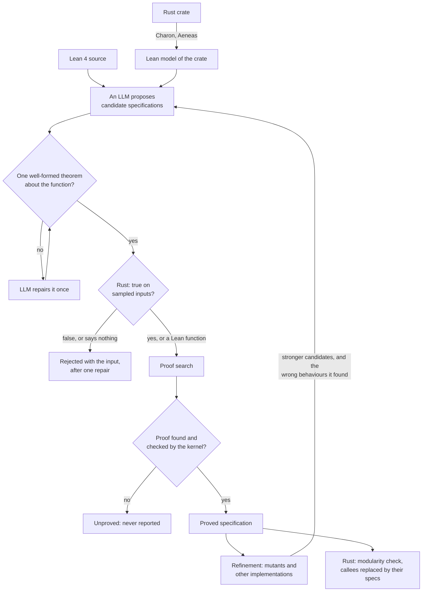

# Kernel-proved specification synthesis

Verifying a program means proving that it meets a specification, and writing
the specification is often the hardest part. This project synthesizes
specifications for Lean 4 and Rust functions and proves them in Lean. Only
specifications whose proofs the Lean kernel has checked are reported, so every
result is a proved statement about the code (for Rust, about its translation
by Aeneas).

> **Work in progress.** The project is under active development and its interfaces may change.

## Pipeline



- **Generate: an LLM proposes properties of each function's behaviour.** It reads
  the function's definition, the types it uses and the proved specifications of
  the functions it calls; Rust is first translated into a pure Lean model by
  Charon and Aeneas, with no annotations on the Rust code.
- **Check: cheap tests discard false and empty candidates before any proof is
  tried.** A candidate must elaborate as one theorem about the function applied
  to its own variables, and a Rust candidate is also run on sampled inputs, so a
  false one is refuted with a shrunk counterexample and one that accepts every
  wrong output is rejected as saying nothing.
- **Prove: a candidate becomes a result only when the Lean kernel checks its
  proof.** Proof search runs Aeneas's `step*`, a tactic portfolio, LeanHammer
  and lemma decomposition, and the finished proof may use no axioms beyond
  `propext`, `Classical.choice` and `Quot.sound`.
- **Refine: wrong programs that the specifications fail to rule out show where
  they are too weak.** Mutants of the function and other implementations that
  satisfy every proved specification are classified by proof; what survives is
  recorded as a wrong behaviour and shown to the LLM in later prompts, and a
  stronger statement replaces a proved one only when it implies it, is not
  implied by it, and is itself proved.

## Quick start

Needs Linux or WSL, Python 3.11+, several GB of disk for the Lean projects, and
an Anthropic API key.

```
curl https://raw.githubusercontent.com/leanprover/elan/master/elan-init.sh -sSf | sh   # Lean's toolchain manager
git clone https://github.com/Isabelle9999/lean-spec-syn && cd lean-spec-syn
pip install -r requirements.txt
bash scripts/setup_lean.sh all        # builds Lean v4.31.0 with Aeneas, Mathlib and LeanHammer under ~/lss_lean (slow the first time)
export ANTHROPIC_API_KEY=<your key>
```

Then:

```
python run.py --rust-project <dir> --bench rust_<function>   # one Rust function
python run.py --rust-project <dir>                           # every function in the crate
python run.py --bench <name>                                 # a built-in Lean benchmark (benchmarks.py)
```

`<dir>` is a crate translated by Aeneas at the pinned version: its
`translation.json` next to `<Crate>/Code/*.lean`. Each run writes a report per
function to `.lss/reports/` and an event log to `.lss/runs/`.

## Repository layout

| Path | Purpose |
|---|---|
| `run.py`, `synth.py`, `strategies.py` | generation, the checks in order, proof search and refinement |
| `gate.py`, `bounded.py`, `lean.py`, `lean/` | the checks and every call into Lean |
| `tools/bench.py`, `bench/split.json` | the fixed dev/test split, runs and comparisons |
| `tests/`, `scripts/check.sh` | tests with known answers, and the merge check |

## Checks

```
pip install ruff pyright==1.1.391
bash scripts/check.sh          # the merge check: lint, types, static and Lean tests
```
